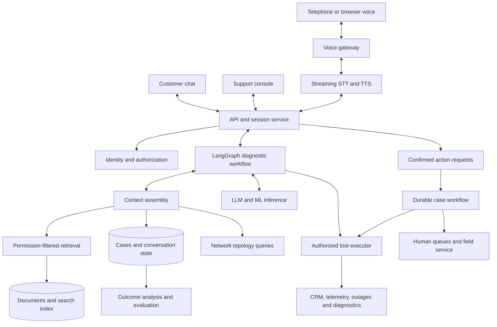
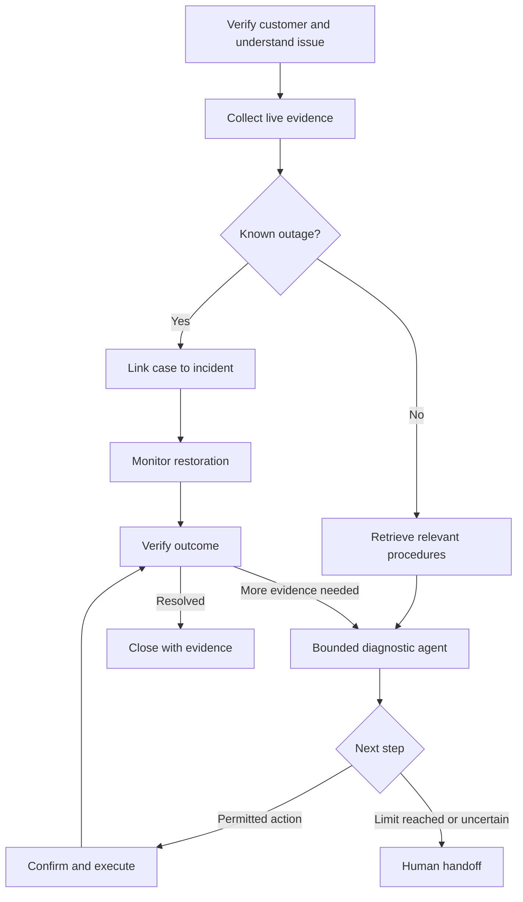

# Service Resolution System Architecture

The architecture separates documented knowledge, live operational facts, predictions, business authority, and model-generated interpretation. Customer identity and external action permissions are enforced by application services.

## Component flow



## Responsibilities and ownership

| Component | Owns | Important boundary |
| --- | --- | --- |
| API and session service | Authentication integration, channel sessions, request validation | Derives customer scope from trusted identity |
| Case service | Business state, outcomes, action ledger, audit references | Canonical application case record |
| LangGraph | Diagnostic state, evidence gathering, questions, bounded branching | Does not grant authority or own appointments |
| Context assembler | Selection, provenance, freshness, token budgets | Keeps untrusted documents distinct from instructions |
| Retrieval service | Permission-filtered knowledge search and citations | Retrieves documented knowledge, not live service truth |
| ML inference | Calibrated predictions and classifier outputs | Predictions remain distinguishable from observations |
| Model adapter | Model calls, normalized errors, usage records | Credentials remain outside prompts and tool outputs |
| Tool executor | Authorization, input validation, execution, audit | Rechecks authority immediately before execution |
| Temporal | Long-running appointments, callbacks, restoration monitoring | Owns durable business waits and retries |
| Voice gateway | Audio sessions, playback, interruption, transfer | Cancels stale audio and propagates cancellation |
| ISP systems | Accounts, appointments, incidents, current telemetry | Remain authoritative for their respective records |

Use a modular backend with separately deployable API, ingestion, and workflow workers. Split additional services when scaling, security, or ownership warrants it.

## Diagnostic graph



LangGraph owns the diagnostic run and checkpoints. Temporal is introduced when the product needs durable waits across appointments and incident restoration. The case service stores stable business identifiers and links both execution systems to the same case. Avoid having both engines independently retry the same external action.

LangGraph supports persisted graph state and interruptions for external input. Side effects still require explicit protection against duplication. [Persistence](https://docs.langchain.com/oss/python/langgraph/persistence), [interrupts](https://docs.langchain.com/oss/python/langgraph/interrupts)

## Network relationship graph

```text
Customer → Service → Device → AccessEquipment → NetworkSegment
                                  ↑                  ↑
                             Observation        ActiveIncident
```

Model entity identifiers, relationship validity periods, source system, and update time. Use versioned PostgreSQL edge tables initially. Move a read projection to Neo4j when bounded traversal queries become difficult to maintain or fail performance targets.

Queries should identify affected services, shared upstream equipment, relevant incidents, and correlated complaints. Keep inferred fault hypotheses separate from authoritative topology and observed alarms. Benchmark graph-assisted retrieval before adopting GraphRAG for broader answer generation.

## Data model

| Group | Core entities |
| --- | --- |
| Customer service | Customer, Service, Device, NetworkAsset |
| Operational events | Incident, Observation |
| Case management | Case, Conversation, Action, Appointment, Outcome |
| Knowledge | Document, Chunk, Permission |
| Governance | AuditEvent, ReleaseManifest, EvaluationRun |

Each observation includes its source, event time, collection time, and service or asset identifier. Link actions to authorization scope, confirmation, external identifiers, and outcome verification. Use correlation identifiers across sessions, cases, tool calls, and background workflows.

Store source documents, dataset snapshots, and large artifacts in Blob Storage. Store business state and references in PostgreSQL. Keep recording storage separate from routine operational logs, with explicit access and retention controls.

## Retrieval pipeline

```text
Approved source → extraction or OCR → structure-aware chunks
→ metadata and permissions → embeddings and keyword index
→ filtered retrieval → rank fusion → reranking → cited answer
```

Metadata includes document owner, version, effective date, equipment model, language, and permissions. Implement revocation, deletion propagation, and reproducible index rebuilds. Evaluate exact equipment codes and multilingual queries as separate retrieval cases.

## Context structure

```text
Verified identity and service scope
Customer symptoms and corrections
Confirmed facts with sources and timestamps
Previous actions and observed results
Relevant retrieved procedures
Unresolved questions and hypotheses
Permitted tools and remaining execution budget
```

Assemble a compact working context rather than continually appending full history. Preserve critical facts through summarization, refresh expired telemetry, and separate customer statements, tool results, retrieved text, and system policy. Context selection should prioritize relevant information within a finite attention budget. [Context engineering guidance](https://www.anthropic.com/research/effective-context-engineering-for-ai-agents)

## Tool contracts

Initial tools:

```text
get_service_status()
get_active_outages()
get_recent_connection_metrics()
get_device_details()
get_existing_cases()
run_approved_line_test()
```

Controlled write tools later add ticket creation, incident linking, and appointment management. Each contract defines typed input and output schemas, authority, side effects, timeout, retry policy, freshness, sensitivity, error types, and idempotency behavior.

The server supplies or validates customer and service identifiers against authenticated scope. Model output is an action proposal. A successful schema parse does not authorize execution.

## Loop and harness controls

```text
Observe → choose permitted next step → execute
→ validate result → update case → continue or exit
```

Bound step count, elapsed time, token use, cost, and repeated unsuccessful actions. Detect lack of progress. Provide cancellation, per-case concurrency control, schema repair limits, trace correlation, and explicit termination reasons.

Exit on verified success, customer request, insufficient evidence, unavailable dependencies, budget exhaustion, or a required human decision. If live data is unavailable, disclose the evidence gap and route the case appropriately rather than inventing a current status.

## Durable external actions

```text
Proposed → Awaiting confirmation → Accepted → In progress
→ Succeeded / Failed / Outcome unknown
```

Bind confirmation to the exact action payload, customer, case, expiry, and relevant state version. Revalidate authorization and preconditions before execution.

Use an action ledger, transactional outbox, idempotency keys, and external identifiers. If a request times out after the external system may have applied it, reconcile its status before another write. A compensating action is a new business action and must follow its own policy.

Temporal preserves workflow progress; Activity retries require application-level idempotency to avoid duplicate side effects. [Durable execution](https://docs.temporal.io/durable-execution), [Activities](https://docs.temporal.io/activities)

## Voice interaction

```text
Call audio → codec conversion and buffering → streaming STT
→ turn detection → diagnostic workflow → response text
→ streaming TTS → call playback
```

Support interruption, backpressure, reconnect, uncertain-entity confirmation, and human transfer. On interruption, stop pending playback and cancel obsolete generation. Reconfirm or invalidate any pending action whose meaning changed after a customer correction. Never use a partial transcript alone to authorize a sensitive action.
